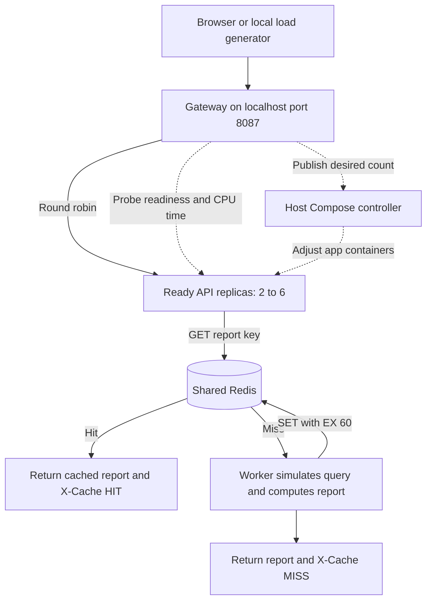

# Week 07 · Cache-aside and CPU-driven scaling

José Antonio Horta Herrera · AD371 Application Architecture

A report lookup simulates a 500 ms database read and a small CPU-intensive report calculation. A shared Redis instance caches the serialized result for 60 seconds. A Python gateway routes requests across ready API replicas. The primary demo uses Docker Compose on Docker Desktop. It requires no cloud account, API key or host Python installation.

## Architecture and request flow

(docs/Architecture.pdf).



Every request goes through the same gateway. Docker DNS supplies the current replica addresses. A probe every two seconds admits workers that can reach Redis. A request for `GET /api/data/product-42` looks up `report:v1:product-42`. On a miss the responding worker computes the result and sets the value and TTL in a single command. Every worker sees it. Reads do not extend the TTL. Responses carry `X-Cache`, `X-Replica`, and `Cache-Control: no-store` so browser caching cannot mask Redis behavior. The origin is simulated. Simultaneous cold reads of one ID may duplicate work before the first write. The demo uses one Redis and one gateway; its scaling scope is the API tier.

## Run on your Mac with Docker Compose

**Prerequisites:** Docker Desktop running, Compose v2 or newer, a shell and curl. From the extracted project directory open two terminals. The first build downloads Python packages and Redis. The Mac only publishes port 8087 on loopback.

**Terminal A — start the stack and keep the controller running.**

```bash
bash scripts/start.sh
```

The script builds the image once, starts Redis, two API replicas and the gateway, waits for health checks, and applies changes using Compose. Leave Terminal A open throughout the load test. Docker Compose alone keeps a fixed replica count. The controller runs on the host, so the app never needs the Docker socket.

**Terminal B — open the dashboard and confirm the baseline.**

```bash
open http://localhost:8087
docker compose ps
docker compose exec -T gateway python -m scripts.cache_check
```

The cache check generates a fresh ID, asserts a miss of at least 500 ms, a first hit and median hit below 15 ms, identical values across different replicas, and a positive decreasing TTL. Reported latency is local HTTP round trip through the gateway.

### Inspect an individual lookup and its TTL

Run these lines together. The second command reuses the first request's ID, even if you repeat the entire demo.

```bash
KEY="demo-$(date +%s)"
curl -sS -i -w '\nTime: %{time_total}s\n' "http://localhost:8087/api/data/$KEY"
curl -sS -i -w '\nTime: %{time_total}s\n' "http://localhost:8087/api/data/$KEY"
docker compose exec -T redis redis-cli TTL "report:v1:$KEY"
sleep 2
docker compose exec -T redis redis-cli TTL "report:v1:$KEY"
```

In the browser, open Developer Tools → Network. Use a fresh ID and click **Fetch report** twice. Inspect the two report requests' response headers. The page displays status, cache result, elapsed time, and replica name. Inspect Console for errors and check health in the terminal.

### Trigger scaling and watch cooldown

Before starting, wait for **2 ready workers**. From Terminal B run the full test (for the video use 95 seconds). It generates traffic and prints actual ready worker IDs, CPU, desired capacity and the cooldown. It exits unsuccessfully if the required transitions or successful requests are missing.

```bash
docker compose exec -T gateway python -m scripts.verify_scaling --seconds 95
```

Each of the 24 clients holds at most one outstanding request. Fresh keys exercise the expensive path. The tool only targets localhost inside the gateway. The dashboard and Terminal A show scaling live. You can verify the container count in a third terminal with `docker compose ps app`. To use a separate load generator and monitor instead, run each of these commands in a separate terminal:

```bash
docker compose exec -T gateway python -m scripts.watch
docker compose exec -T gateway python -m scripts.load --seconds 75
```

### Scaling policy

| Setting | Value and reason |
|---|---|
| CPU input | For each ready worker, change in process CPU seconds divided by elapsed wall seconds. Divide summed CPU cores used by total requested cores. A missing sample holds the decision. |
| Resource budget | Each worker reserves 0.20 core and 32 MB in Compose, capped at 0.50 core and 128 MB. At two workers, 0.20 core total consumed equals 50% utilization of their combined reservation. Values above 100% of the reservation are possible. |
| Increase | Above 50% for two consecutive complete samples, add two, up to six. Wait for the new membership to become ready. |
| Decrease | Below 20% continuously for 30 seconds, return to two. A rebound resets the window. |
| Detection | Readiness and DNS sampling refresh the pool approximately every two seconds. A read has at most one connection-failure retry. |

### Final checks and shutdown

```bash
curl -fsS http://localhost:8087/healthz
docker compose exec -T gateway python -m unittest -v tests.test_policy
docker compose ps
docker compose logs --tail=30 app redis gateway
```

Press Ctrl+C in **Terminal A** to stop the controller, then run `docker compose down`. The Redis data is intentionally ephemeral. If the fleet stays at two, check Terminal A is still running, use fresh keys, and inspect the CPU signal in the dashboard. Warm hits can be too inexpensive to trigger growth. If four replicas keep CPU below the 50% growth threshold on a faster machine, wait for baseline and repeat the verifier with `--clients 32`.

## Alternative deployment with Minikube HPA

Choose one deployment for a recording. The Docker Compose route above needs no Kubernetes installation. For the Kubernetes route, install Minikube and kubectl and use Docker Desktop as the driver. A headless Service publishes ready API pod addresses. The native HPA reads pod CPU from metrics-server. The dashboard displays observed process CPU; `kubectl get hpa` shows the authoritative Kubernetes utilization and target.

```bash
minikube start --driver=docker
minikube addons enable metrics-server
minikube image build -t week07-cache-lab:local .
kubectl create namespace week07-cache
kubectl -n week07-cache apply -f k8s/lab.yaml
kubectl -n week07-cache rollout status deployment/report-gateway
kubectl -n week07-cache top pods
kubectl -n week07-cache get hpa
kubectl -n week07-cache port-forward svc/report-gateway 8087:8087
```

Wait for numeric pod metrics after startup. The HPA uses `requests.cpu: 200m`, a 50% target, two to six pods and a 30-second downscale stabilization window. Its sampling and readiness rules differ from the Compose policy. In separate terminals use:

```bash
kubectl -n week07-cache get hpa -w
kubectl -n week07-cache get pods -w
kubectl -n week07-cache exec deploy/report-gateway -- python -m scripts.cache_check
kubectl -n week07-cache exec deploy/report-gateway -- python -m scripts.load --seconds 100
```

Redis inspection: `kubectl -n week07-cache exec deploy/report-redis -- redis-cli TTL report:v1:YOUR_ID`. Clean up the lab resources with `kubectl -n week07-cache delete -f k8s/lab.yaml`.

## AI assistance and prompt appendix

The draft selected shared Redis correctly. It omitted TTL and shrank the fleet immediately below the scale-out threshold. The final implementation writes with EX 60, defines resource budgets, and waits for sustained low CPU.

## Measured QA results

See [the QA checklist](docs/QA.md), [raw fleet measurements](docs/qa-run.json) and [browser observations](docs/browser-qa.json). The recorded run used a real external Redis server, separate HTTP worker processes and a local process actuator exercising the same gateway policy. Docker and Minikube were unavailable on the verification host. Run the deployment-specific commands above to capture container or pod evidence for the video.

